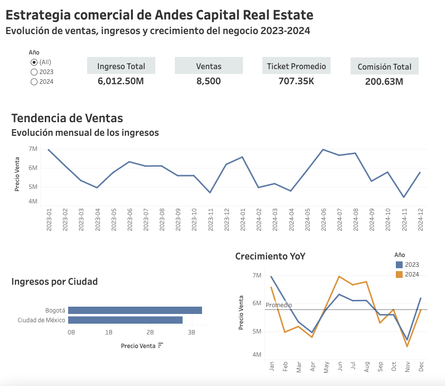
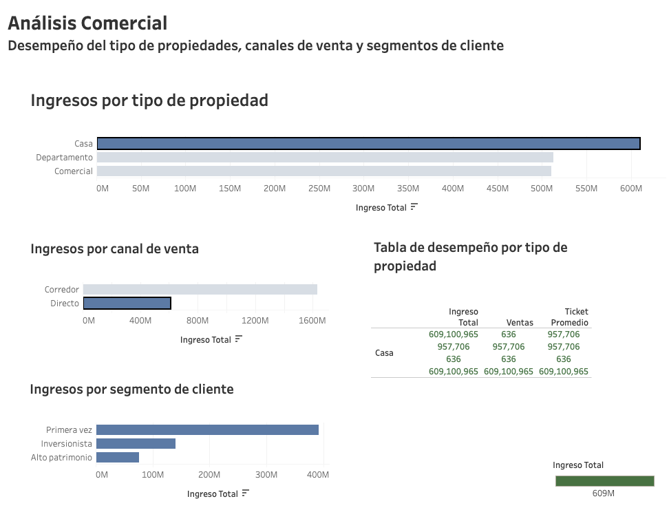
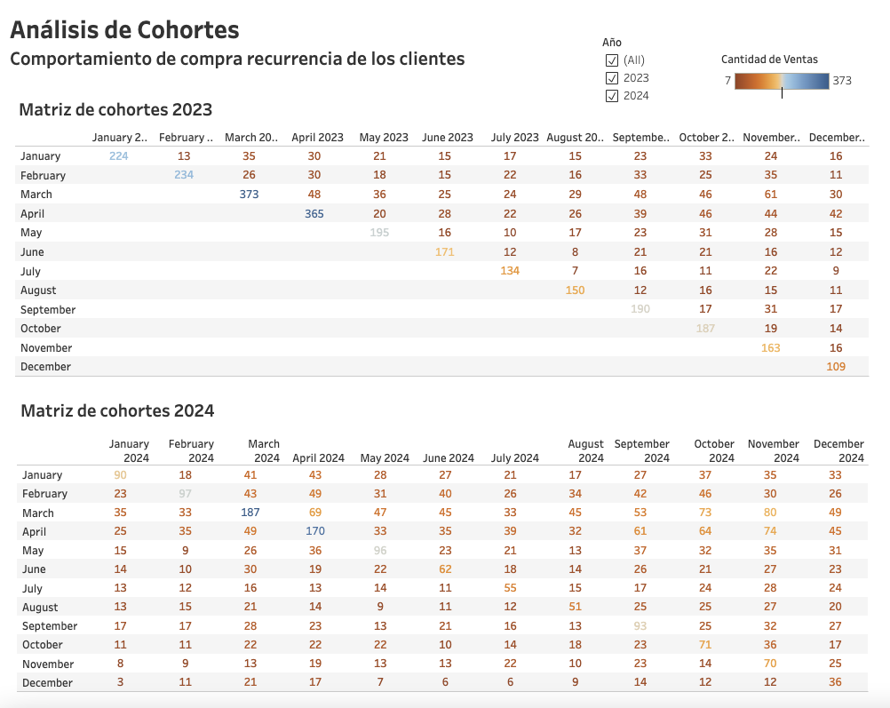

# Andes Capital Real Estate: dashboard de desempeño comercial

Caso de negocio simulado del bootcamp de Data Analytics de TripleTen. Los datos son de práctica.

## Pregunta de negocio
¿Qué impulsa los ingresos de la empresa y qué tan estable es la relación con sus clientes?

## Dashboard
[Ver en Tableau Public](https://public.tableau.com/views/Dashboard_Andes-Capital-Real-Estate/1OverviewEjecutivo)

Tres páginas: **Overview Ejecutivo**, **Análisis Comercial** y **Análisis de Cohortes**.

## Métricas principales (2023–2024)
| Métrica | Valor |
|---|---|
| Ingreso total | 6,012.5 M |
| Ventas cerradas | 8,500 |
| Ticket promedio | 707.35 K |
| Comisión total | 200.63 M (~3.3% del ingreso) |

| Tipo de propiedad | Ingreso | Ventas | Ticket |
|---|---|---|---|
| Casa | 2,240.5 M | 2,324 | 964 K |
| Comercial | 1,924.7 M | 1,071 | 1.8 M |
| Departamento | 1,847.3 M | 5,105 | 362 K |

## Hallazgos principales
- Los ingresos tienen una estacionalidad marcada: repuntan entre mayo y agosto y caen en noviembre, en ambos años.
- Bogotá concentra más ingresos que Ciudad de México.
- El canal Corredor domina sobre el canal Directo en los tres tipos de propiedad.
- El segmento Primera vez es el que más ingresos genera.
- La recurrencia cae con fuerza tras el primer mes: la cohorte de marzo de 2023 pasa de 373 transacciones a menos de 50.

## Recomendaciones
- **Diversificar canales:** fortalecer el canal Directo para reducir la dependencia de corredores.
- **Fidelización:** crear incentivos para convertir compradores de Primera vez en clientes recurrentes.
- **Planificación estacional:** anticipar campañas antes de la caída de noviembre.
- **Mezcla de producto:** usar Departamento como producto de entrada y llevar Comercial hacia clientes de alto patrimonio e inversionistas.

## Herramientas
Tableau (modelo de esquema estrella, medidas, KPIs, análisis YoY y cohortes).
